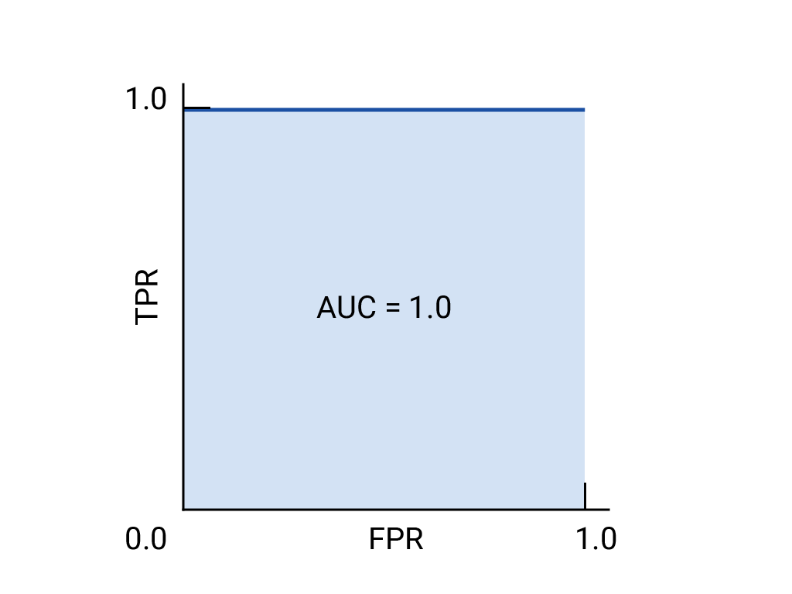
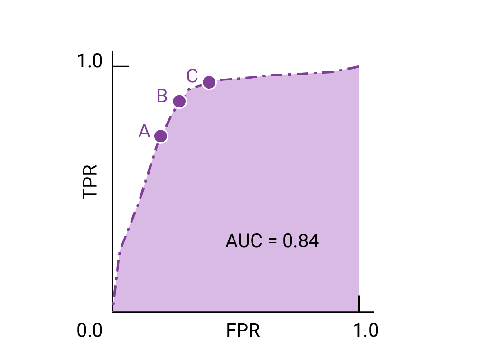

In the [logistic regression](../Logistic%20Regression/Logistic%20Regression.md) module, we learned how to use the **sigmoid function** to convert raw model output to a value between $0$ and $1$ to make probabilistic prediction - for example, predicting that a given email has a $75\%$ change of being spam. But what if your goal is not to output probability but a category - for example, predicting whether a given email is "spam" or "not spam"?

**Classification** is the task of predicting which set of classes (categories) an example belongs to. 

# Thresholds and the confusion matrix 

Let's say you have a logistic regression model for spam-email detection that predicts a value between $0$ and $1$, representing the probability that a given email is spam. A prediction of $0.50$ signifies a $50\%$ chance that the email is spam, a prediction of $0.75$ signifies a $75\%$  chance that the email is spam, and so on.

You'd like to deploy this model in an email application to filter spam into a separate mail folder. But to do so, you need to convert the model's raw numerical output (e.g., $-0.75$) into one of two categories: "spam" or "not spam".

To make this conversion, you choose a threshold probability, called a **classification threshold**. Examples with a probability above the threshold value are then assigned to the **positive class**, the class you are testing for (here, `spam`). Examples with a lower probability are assigned to the **negative class**, the alternative class (here, `not spam`).

### What would happen if the score is equal to threshold?

It depends on the particular implementation of the chosen model. Some may go negative and some may go positive. 

## Confusion matrix 

The probability score is not reality, or [**ground truth**](https://developers.google.com/machine-learning/glossary#ground_truth). There are four possible outcomes for each output from a binary classifier. For the spam classifier example, if you lay out the ground truth as columns and the model's prediction as rows, the following table, called a [**confusion matrix**](https://developers.google.com/machine-learning/glossary#confusion_matrix), is the result:

|                    | **Actual positive**                                                                                                                                             | **Actual negative**                                                                                                                             |
| ------------------ | --------------------------------------------------------------------------------------------------------------------------------------------------------------- | ----------------------------------------------------------------------------------------------------------------------------------------------- |
| Predicted positive | **True positive (TP)**: A spam email correctly classified as a spam email. These are the spam messages automatically sent to the spam folder.                   | **False positive (FP)**: A not-spam email misclassified as spam. These are the legitimate emails that wind up in the spam folder.               |
| Predicted negative | **False negative (FN)**: A spam email misclassified as not-spam. These are spam emails that aren't caught by the spam filter and make their way into the inbox. | **True negative (TN)**: A not-spam email correctly classified as not-spam. These are the legitimate emails that are sent directly to the inbox. |

Notice that the total in each row gives all predicted positives (TP + FP) and all predicted negatives (FN + TN), regardless of validity. The total in each column, meanwhile, gives all real positives (TP + FN) and all real negatives (FP + TN) regardless of model classification.

When the total of actual positives is not close to the total of actual negatives, the dataset is [**imbalanced**](https://developers.google.com/machine-learning/glossary#class_imbalanced_data_set). An instance of an imbalanced dataset might be a set of thousands of photos of clouds, where the rare cloud type you are interested in, say, volutus clouds, only appears a few times.

# Accuracy, recall, precision, and related metrics 

True and false positives and negatives are used to calculate several useful metrics for evaluating models. Which evaluation metrics are most meaningful depends on the specific model and the specific task, the cost of different misclassifications, and whether the dataset is balanced or imbalanced.

## Accuracy 

**Accuracy** is the proportion of all classifications that were correct, whether positive or negative. It is mathematically defined as: 

$$\text{Accuracy} = \frac{\text{correct classifications}}{\text{total classifications}} = \frac{TP + TN}{TP + TN + FP + FN}$$

In the spam classification example, accuracy measures the *fraction of all emails correctly classified*.

A perfect model would have zero false positives and zero false negatives, and therefore an accuracy of $1.0$ or $100\%$.

Because _accuracy_ incorporates all four outcomes of the _confusion matrix_, this evaluation metric is the default for generic or unspecified models carrying out generic or unspecified tasks. 

However, when the dataset is imbalanced, or where one kind of mistake (FN or FP) is more costly than the other, which is the case in most real-world applications, it's better to optimize for one of the other metrics instead.

For heavily imbalanced datasets, where one class appears very rarely, say $1\%$ of the time, a model that predicts negative $100\%$ of the time would score $99\%$ on accuracy, despite being useless.

## Recall, or true positive rate 

The **true positive rate (TPR)**, or the proportion of all actual positives that were classified correctly as positives, is also known as **recall**.

Recall is mathematically defined as:

$$\text{Recall (or TPR)} = \frac{\text{correctly classified actual positives}}{\text{all actual positives}} = \frac{TP}{TP + FN}$$

False negatives are actual positives that were misclassified as negatives, which is why they appear in the denominator. In the spam classification example, recall measures the _fraction of spam emails that were correctly classified as spam._ This is why another name for recall is **probability of detection**: it answers the question "What fraction of spam emails are detected by this model?"

A hypothetical perfect model would have zero false negatives and therefore a recall (TPR) of $1.0$, which is to say, a $100\%$ detection rate.

In an imbalanced dataset where the number of actual positives is very low, recall is a more meaningful metric than accuracy because it measures the ability of the model to correctly identify all positive instances.

## False positive rate 

The [**false positive rate (FPR)**](https://developers.google.com/machine-learning/glossary#false-positive-rate-fpr) is the proportion of all actual negatives that were classified _incorrectly_ as positives, also known as the **probability of false alarm.** It is mathematically defined as:

$$\text{FPR} = \frac{\text{incorrectly classified actual negatives}}{\text{all actual negatives}} = \frac{FP}{FP + TN}$$

False positives are actual negatives that were misclassified, which is why they appear in the denominator. In the spam classification example, FPR measures the _fraction of legitimate emails that were incorrectly classified as spam,_ or the model's rate of false alarms.

A perfect model would have zero false positives and therefore a FPR of $0.0$, which is to say, a $0\%$ false alarm rate.

In cases where the actual negatives in the dataset are very low, FPR is not preferred, _precision_ (discussed next) is more stable.

## Precision 

[**Precision**](https://developers.google.com/machine-learning/glossary#precision) is the proportion of all the model's positive classifications that are actually positive. It is mathematically defined as:

$$\text{Precision} = \frac{\text{correctly classified actual positives}}{\text{everything classified as positive}} = \frac{TP}{TP + FP}$$

In the spam classification example, precision measures the _fraction of emails classified as spam that were actually spam._

A hypothetical perfect model would have zero false positives and therefore a precision of $1.0$.

In an imbalanced dataset where the number of actual positives is very, very low, say 1 - 2 examples in total, precision is less meaningful and less useful as a metric.

Precision improves as false positives decrease, while recall improves when false negatives decrease.

## Choice of metric and tradeoffs 

The metric(s) you choose to prioritize when evaluating the model and choosing a threshold depend on the costs, benefits, and risks of the specific problem.

| Metric                           | Guidance                                                                                                                                                                                                                              |
| -------------------------------- | ------------------------------------------------------------------------------------------------------------------------------------------------------------------------------------------------------------------------------------- |
| Accuracy                         | Use as a rough indicator of model training progress/convergence for balanced datasets.  For model performance, use only in combination with other metrics.  Avoid for imbalanced datasets. Consider using another metric. |
| Recall   (True positive rate) | Use when false negatives are more expensive than false positives.                                                                                                                                                                     |
| False positive rate              | Use when false positives are more expensive than false negatives.                                                                                                                                                                     |
| Precision                        | Use when it's very important for positive predictions to be accurate.                                                                                                                                                                 |

# ROC and AUC 

Till now we used model metrics that calculated at a *single* classification threshold value. But if you want to evaluate a model's quality across all possible thresholds, you need different tools.

## Receiver-operating characteristic curve (ROC)

The [**ROC curve**](https://developers.google.com/machine-learning/glossary#roc-receiver-operating-characteristic-curve) is a visual representation of model performance across all thresholds.

The ROC curve is drawn by calculating the true positive rate (TPR) and false positive rate (FPR) at every possible threshold (at selected intervals), then graphing TPR over FPR. A perfect model, which at some threshold has a TPR of $1.0$ and a FPR of $0.0$, can be represented by either a point at (0, 1) if all other thresholds are ignored, or by the following:

Fig. ROC and AUC of a hypothetical perfect model.

## Area under the curve (AUC)

The [**area under the ROC curve (AUC)**](https://developers.google.com/machine-learning/glossary#AUC) represents the probability that the model, if given a randomly chosen positive and negative example, will rank the positive higher than the negative.

The perfect model above, containing a square with sides of length 1, has an area under the curve (AUC) of 1.0. This means there is a $100\%$ probability that the model will correctly rank a randomly chosen positive example higher than a randomly chosen negative example. In other words, looking at the spread of data points below, AUC gives the probability that the model will place a randomly chosen square to the right of a randomly chosen circle, independent of where the threshold is set.

In more concrete terms, a spam classifier with AUC of 1.0 always assigns a random spam email a higher probability of being spam than a random legitimate email. The actual classification of each email depends on the threshold that you choose.

For a binary classifier, a model that does exactly as well as random guesses or coin flips has a ROC that is a diagonal line from (0, 0) to (1, 1). The AUC is 0.5, representing a $50\%$ probability of correctly ranking a random positive and negative example.

In the spam classifier example, a spam classifier with AUC of 0.5, assigns a random spam email a higher probability of bein spam than a random legitimate email only half the time.

>What the above two paragraphs are saying is that suppose that a model's score carry no real information, so its just flipping a coin. There are equal chances of a email marked as spam or not spam.

>If a model is performing worst than chance (0.5), it is a good idea to switch classes. 0 becomes 1 and 1 becomes 0.

## AUC and ROC for choosing model and threshold 

AUC is a useful measure for comparing the performance of two different models, as long as the dataset is roughly balanced. The model with greater area under the curve is generally the better one.

Fig. ROC and AUC of two hypothetical models. The curve on the right, with a greater AUC, represents the better of the two models.

The points on a ROC curve closest to (0,1) represent a range of the best-performing thresholds for the given model. Choosing a threshold depends on the use case. Consider the points A, B, and C in the following diagram, each representing a threshold:

If false positives (false alarms) are highly costly, it may make sense to choose a threshold that gives a lower FPR, like the one at point A, even if TPR is reduced. Conversely, if false positives are cheap and false negatives (missed true positives) highly costly, the threshold for point C, which maximizes TPR, may be preferable. If the costs are roughly equivalent, point B may offer the best balance between TPR and FPR.

# Prediction bias 

Calculating [**prediction bias**](https://developers.google.com/machine-learning/glossary#prediction_bias) is a quick check that can flag issues with the model or training data early on.

Prediction bias is the difference between the mean of a model's [**predictions**](https://developers.google.com/machine-learning/glossary#prediction) and the mean of [**ground-truth**](https://developers.google.com/machine-learning/glossary#ground-truth) labels in the data. A model trained on a dataset where 5% of the emails are spam should predict, on average, that 5% of the emails it classifies are spam. In other words, the mean of the labels in the ground-truth dataset is 0.05, and the mean of the model's predictions should also be 0.05. If this is the case, the model has zero prediction bias. Of course, the model might still have other problems.

If the model instead predicts 50% of the time that an email is spam, then something is wrong with the training dataset, the new dataset the model is applied to, or with the model itself. Any significant difference between the two means suggests that the model has some prediction bias.

Prediction bias can be caused by:

- Biases or noise in the data, including biased sampling for the training set
- Too-strong regularization, meaning that the model was oversimplified and lost some necessary complexity
- Bugs in the model training pipeline
- The set of features provided to the model being insufficient for the task

# Multi-class classification

Multi-class classification can be treated as an extension of [**binary classification**](https://developers.google.com/machine-learning/glossary#binary_classification) to more than two classes. If each example can only be assigned to one class, then the classification problem can be handled as a binary classification problem, where one class contains one of the multiple classes, and the other class contains all the other classes put together. The process can then be repeated for each of the original classes.

For example, in a three-class multi-class classification problem, where you're classifying examples with the labels **A**, **B**, and **C**, you could turn the problem into two separate binary classification problems. First, you might create a binary classifier that categorizes examples using the label **A+B** and the label **C**. Then, you could create a second binary classifier that reclassifies the examples that are labeled **A+B** using the label **A** and the label **B**.

An example of a multi-class problem is a handwriting classifier that takes an image of a handwritten digit and decides which digit, 0-9, is represented.

If class membership isn't exclusive, which is to say, an example can be assigned to multiple classes, this is known as a _multi-label_ classification problem.

# Further Reading 

- [Datacamp - classification machine learning](https://www.datacamp.com/blog/classification-machine-learning)